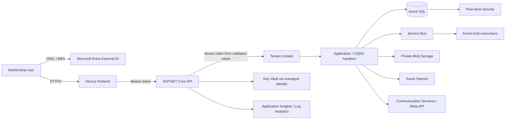

# Architecture overview

## Current delivery boundary

This repository is a starter, not a production SaaS. The frontend dashboard and API summary use illustrative data. The API validates Entra-issued JWTs and requires a UUID `tenant_id` claim, but the claim issuer/app registration has not been configured and persistence is not wired. The SQL script is a proposed schema/RLS baseline, not an applied migration. No external services or Azure resources are deployed.

## Target architecture

The initial deployment targets shared Azure SQL with a `tenant_id` column, tenant-aware repository/query boundaries, and SQL Server RLS. A tenant-specific database can be routed later for regulatory, performance, or contractual isolation needs. Do not use a caller-supplied tenant header as an authorization boundary. Derive tenant identity only from a trusted, validated identity claim and enforce it at both application and database layers.

## Tenancy and identity

- The API accepts Entra JWTs only when signature, issuer, audience, and lifetime validate.
- `tenant_id` must be a UUID emitted by a trusted token-issuance policy; the API rejects missing/malformed values.
- Never treat the Entra directory `tid` as the SaaS tenant ID without an explicit organization-to-tenant mapping.
- Every tenant-owned row includes `tenant_id`; every query and write must apply tenant scope. The SQL RLS predicate in `database/tenant-isolation.sql` is a reference implementation.
- The API must set the SQL `SESSION_CONTEXT` from its authenticated tenant context for every connection and transaction. Test connection-pool reset behavior before rollout.
- Database-per-tenant provisioning and catalog/routing service are future work; this repository does not claim that isolation is complete.
- Entra External ID is the target customer identity. The legacy Azure AD B2C name in the original requirements is not selected as a new-tenant dependency. Customer identity setup requires tenant/domain validation and MFA policy decisions.

## Runtime and service decisions

| Concern | Decision |
| --- | --- |
| Web | Next.js App Router and TypeScript; dashboard is dark-only |
| API | ASP.NET Core 9 starter; JWT bearer authentication, health endpoint, per-process fixed-window rate limiter |
| Persistence | Azure SQL target; SQL DDL/RLS is a proposal and API persistence is not connected |
| Secrets | Managed identity and Key Vault RBAC; no credentials belong in source or workflow parameters |
| Infrastructure | Bicep resource-group template; private data-plane access is the target |
| Telemetry | Application Insights workspace-based component and Log Analytics |
| Customer identity | Entra External ID (not new B2C tenants) |
| Messaging | Advanced resources are gated and off by default pending configuration, cost and consent review |
| Analytics | Power BI Embedded capacity is gated because it has material ongoing cost; no report/model is included |

## Production readiness gaps

Before onboarding Barbearia Avelino or storing personal data: complete the identity app and trusted tenant claim mapping; implement migrations, persistence, SQL RLS connection initialization, repository/use-case boundaries, RBAC, audit retention, consent and LGPD workflows; add private endpoints, VNet integration and private DNS; replace Bicep placeholders; set backups, restore tests, alerts and service objectives; threat-model and pentest; implement complete customer, service, barber, appointment, payments, campaign and AI workflows; review retention and data residency with the controller; and test accessibility, failover, load, cost limits, and tenant isolation.
